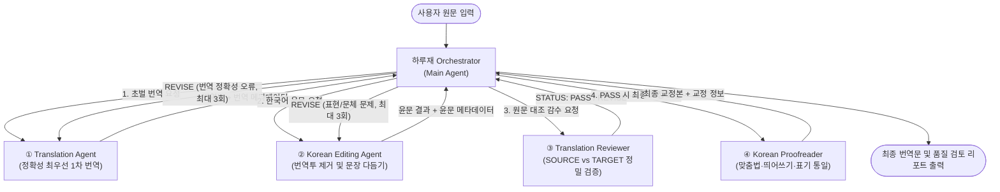

# 하루재 Agent (번역·윤문·감수·교정 Multi-Agent)

**하루재 Agent**는 원문의 정확한 번역부터 자연스러운 한국어 윤문, 원문 대조 감수, 최종 교정까지의 전 과정을 수행하는 **Gemini Enterprise App 전용 Multi-Agent 시스템**입니다.

> [!IMPORTANT]
> 본 프로젝트는 **GCP(Vertex AI 등), GWS(Google Workspace), 별도의 코드 기반 플랫폼 없이** 현재 보유하신 **Gemini Enterprise App 구독 내 내장된 `Agent Designer` (No-Code Multi-Agent Builder)** 만으로 구축 및 운영할 수 있도록 설계되었습니다.

---

## 1. 디렉토리 구조

```text
하루재 Agent/
├── README.md                          # 전체 아키텍처 및 Gemini Enterprise App 설정 가이드
├── agents/                            # Agent Designer 노드에 복사/붙여넣기할 Agent 설정서
│   ├── 00_orchestrator_agent.md       # [Main Agent] 하루재 Orchestrator (총괄 라우터)
│   ├── 01_translation_agent.md        # [Sub-Agent 1] 초벌 번역 (Translation Agent)
│   ├── 02_editing_agent.md            # [Sub-Agent 2] 한국어 윤문 (Korean Editing Agent)
│   ├── 03_review_agent.md             # [Sub-Agent 3] 원문 대조 감수 (Translation Reviewer)
│   └── 04_proofreading_agent.md       # [Sub-Agent 4] 최종 교정 (Korean Proofreader)
├── knowledge/                         # 각 Agent의 Knowledge(파일 첨부)에 업로드할 공통 문서
│   ├── shared_glossary.md             # 공통 전문 용어집 (Glossary)
│   └── shared_style_guide.md          # 하루재 공통 문체·표기 가이드 (Style Guide)
├── schemas/                           # Agent 간 데이터 전달 규격 및 분기 규칙
│   ├── agent_payload_schema.json      # Agent 간 공통 전달 JSON 포맷
│   └── routing_rules.md               # 감수(PASS / REVISE) 조건별 라우팅 규칙
└── tests/                             # Agent Designer 'Preview' 탭 검증용 시나리오
    └── sample_test_prompts.md         # 테스트용 원문 및 검증 체크리스트
```

---

## 2. 전체 워크플로우 아키텍처

Gemini Enterprise App의 **Flow 탭**에서 메인 에이전트(Orchestrator) 아래에 4개의 Sub-Agent를 연결하여 동작합니다.



### 에이전트별 역할 요약

| 구분 | 에이전트명 | 핵심 역할 | 원문 참조 여부 | Knowledge 첨부 파일 |
|---|---|---|---|---|
| **Main Agent** | **Harujae Orchestrator** | 작업 순서 제어, 데이터 전달, REVISE 분기(최대 3회), 최종 출력 | 필수 | `shared_glossary.md`, `shared_style_guide.md` |
| **Sub-Agent 1** | **Translation Agent** | 원문 의미 손실 없는 정확한 1차 초벌 번역 | 필수 | `shared_glossary.md` |
| **Sub-Agent 2** | **Korean Editing Agent** | 의미 변경 없이 번역투 제거 및 자연스러운 한국어 윤문 | 필요 시 참조 | `shared_glossary.md`, `shared_style_guide.md` |
| **Sub-Agent 3** | **Translation Reviewer** | 원문(`SOURCE`)과 윤문본(`TARGET`) 대조 검증 및 `PASS`/`REVISE` 판정 | 필수 | `shared_glossary.md`, `shared_style_guide.md` |
| **Sub-Agent 4** | **Korean Proofreader** | 맞춤법, 띄어쓰기, 문장부호, 표기 일관성 최종 점검 | 선택 | `shared_style_guide.md` |

---

## 3. Gemini Enterprise App 구축 순서 (Step-by-Step)

별도의 클라우드 인프라(GCP)나 외부 도구 없이 **Gemini Enterprise 웹 앱**에서 바로 생성합니다.

1. **Agent Designer 열기**
   - Gemini Enterprise App 좌측 메뉴에서 **Agents (또는 Agent Designer) → `+ New Agent` (새 에이전트 만들기)** 를 클릭합니다.
2. **Main Agent (Orchestrator) 설정**
   - [agents/00_orchestrator_agent.md](./agents/00_orchestrator_agent.md) 파일의 `Name`, `Description`, `Instructions`를 복사하여 메인 에이전트 설정란에 붙여넣습니다.
   - `Knowledge (Files)` 항목에 [knowledge/shared_glossary.md](./knowledge/shared_glossary.md)와 [knowledge/shared_style_guide.md](./knowledge/shared_style_guide.md)를 업로드합니다.
3. **Sub-Agents 4개 추가 (`Flow` 탭)**
   - 상단 **Flow** 탭으로 이동하여 Main Agent 노드 위의 **`+ (Add sub-agent)`** 버튼을 클릭해 총 4개의 Sub-Agent 노드를 추가합니다.
   - 각 Sub-Agent 노드에 `agents/01_...` ~ `agents/04_...` 문서의 `Name`, `Description`, `Instructions`를 각각 붙여넣고 해당 Knowledge 파일을 첨부합니다.
4. **Preview 테스트 및 게시 (Create/Publish)**
   - 우측 **Preview** 탭에서 [tests/sample_test_prompts.md](./tests/sample_test_prompts.md)의 예문을 입력하여 단계별 호출 및 감수 작동 여부를 확인한 뒤 저장/게시합니다.
